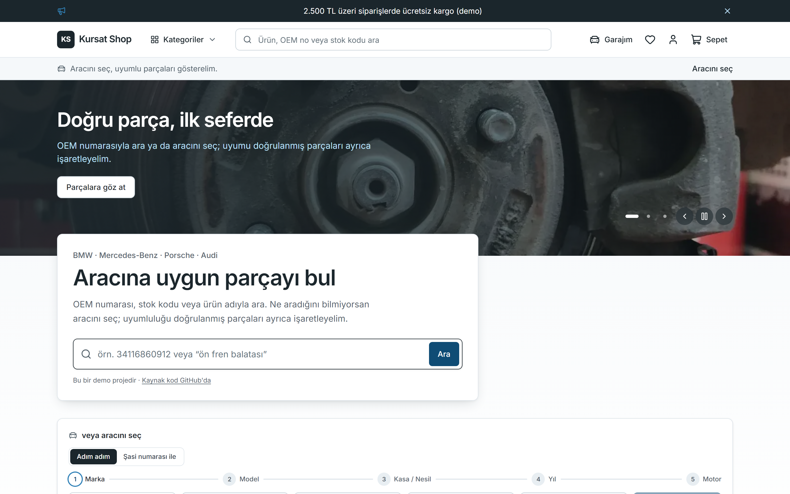
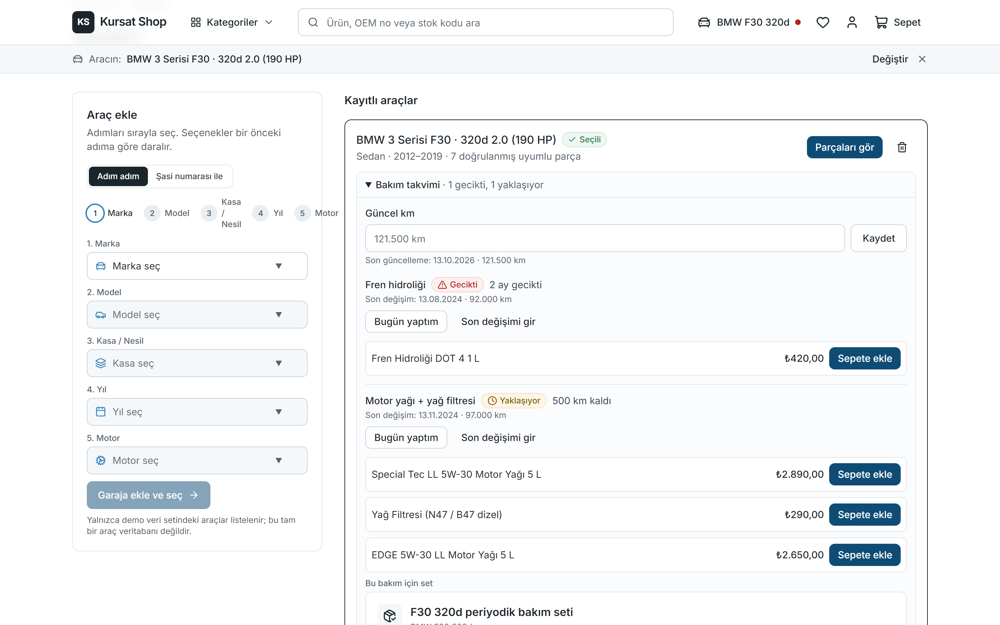
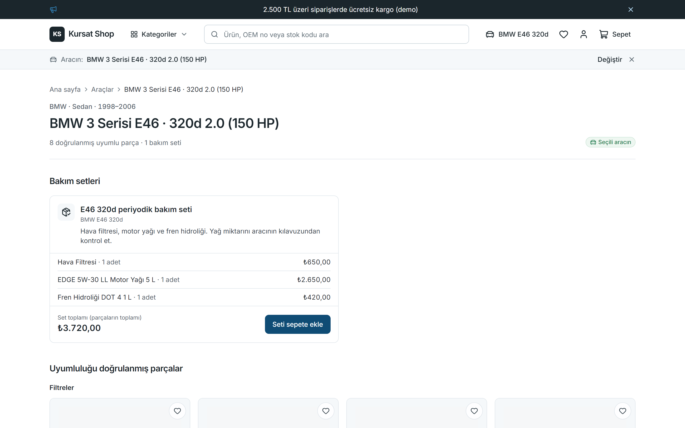
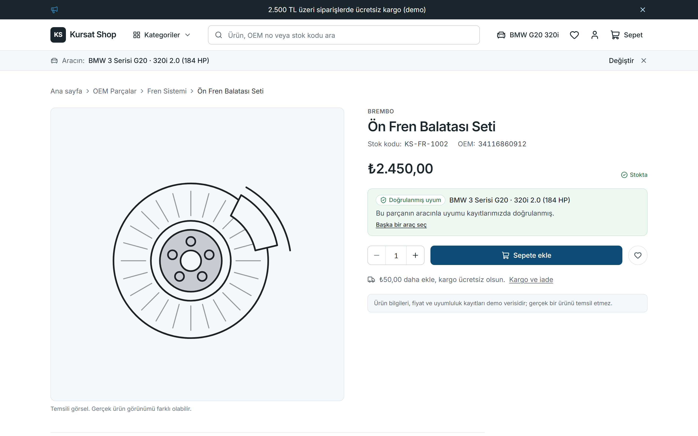
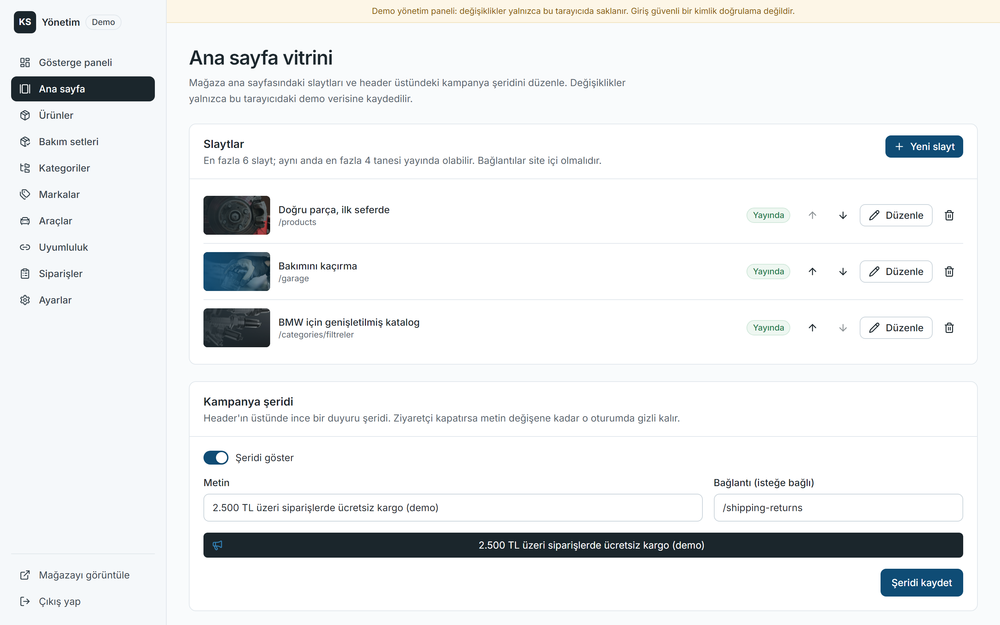
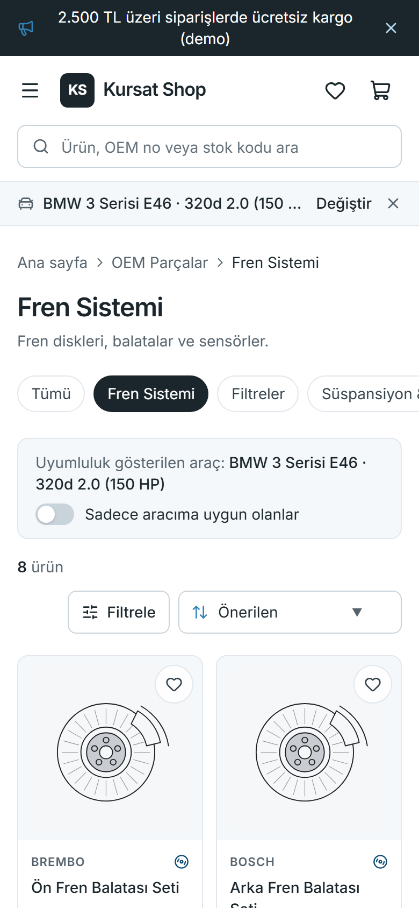
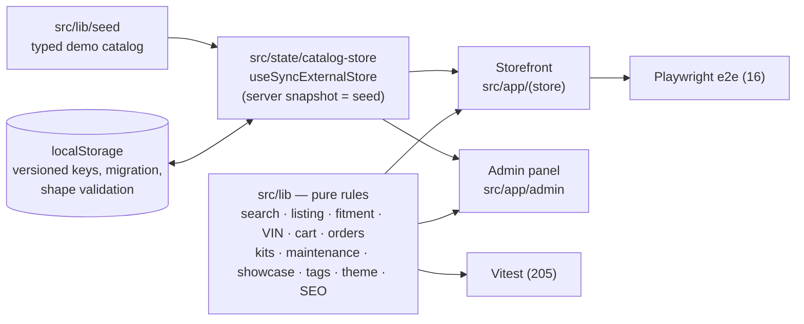

# Kursat Shop — a fitment-first auto parts store

[](https://github.com/kursatdemirdelen/car-parts-shop/actions/workflows/ci.yml)
[](https://car-parts-shop-flame.vercel.app)

**Live demo:** https://car-parts-shop-flame.vercel.app · **Admin:** [/admin](https://car-parts-shop-flame.vercel.app/admin) (demo login is shown on the page)

A complete, working **portfolio prototype** of a Turkish auto parts store focused on German cars — mostly BMW, plus Mercedes-Benz,
Porsche and Audi. It answers the one question that stops people from buying technical parts online — *"will this fit my car?"* —
honestly, and builds everything else around that answer: part-number search, vehicle and VIN selection, a maintenance reminder,
kits, a demo checkout and a full admin panel that also manages the storefront's look.



| Maintenance reminder | Vehicle page with kits | Product page | Admin showcase editor | Mobile listing |
| --- | --- | --- | --- | --- |
|  |  |  |  |  |

---

## Contents

- [Türkçe özet](#türkçe-özet)
- [The problem](#the-problem)
- [What it does](#what-it-does)
- [Product decisions](#product-decisions)
- [Design system](#design-system)
- [Architecture](#architecture)
- [Quality](#quality)
- [Getting started](#getting-started)
- [If this went to production](#if-this-went-to-production)
- [Limitations](#limitations-by-design)
- [Photo credits and sources](#photo-credits)

---

## Türkçe özet

**Kursat Shop**, BMW ağırlıklı (Mercedes-Benz, Porsche ve Audi de var) bir yedek parça mağazasının uçtan uca çalışan **demo**
prototipidir. Projenin çıkış noktası şu soru: *"Bu parça benim arabama uyar mı?"* Uyumluluk yalnızca açık bir kayıt varsa
"Doğrulanmış uyum" olarak gösterilir; kayıt yoksa ürün asla "uyumlu" diye sunulmaz.

**Neler var?**

- **Parça arama:** OEM numarasıyla arama; boşluklu, noktalı ya da Türkçe karakter kullanmadan yazılsa bile çalışır.
- **Araç seçimi:**
  - Adım adım seçici: marka → model → kasa → yıl → motor, ilerlemeyi gösteren adım çubuğuyla.
  - **Şasi numarası (VIN)** ile seçim: yalnızca standart olarak çözülebilen bilgiyi (üretici, tahmini model yılı) gösterir.
- **Garaj ve bakım hatırlatıcısı:** Araç için km ve son bakım tarihleri girilir. Her kalem *Gecikti / Yaklaşıyor / Bilinmiyor / Zamanı var*
  olarak gösterilir ve yanında araca uyumu doğrulanmış parçalar ve setler önerilir. BMW'lerde LongLife örnek aralıkları kullanılır.
- **SEO sayfaları:** Araç sayfaları (`/arac/bmw-f30-320d`) ve OEM sayfaları (`/oem/34116860912`); yapılandırılmış veri, sitemap ve paylaşım görselleriyle.
- **Bakım setleri ve "birlikte değiştirilenler":** Set fiyatı parçaların toplamıdır; sahte indirim yoktur.
- **Ödeme:** Kart bilgisi istemeyen demo ödeme akışı.
- **Yönetim paneli:** Ürün, set, kategori, marka, araç, uyumluluk, sipariş ve ayar yönetimi. Ana sayfa vitrini (slaytlar) ve kampanya
  şeridi de buradan düzenlenir.
- **Tasarım sistemi:**
  - Marka paleti (`#1B262C`, `#0F4C75`, `#3282B8`, `#BBE1FA`), kategori renkleri ve ikonlar.
  - Kısa ve hafif animasyonlar; "hareketi azalt" tercihine uyar.
  - İskelet ve spinner yükleme durumları; 404, hata ve bölüm içi hata ekranları.
- **Kalite:** 205 birim testi, 16 uçtan uca test, her push'ta CI ve Lighthouse ölçümleri.

**Sınırlar:** Backend yoktur; veriler tarayıcıda tutulur, gerçek ödeme veya sipariş işlenmez. Ürün, fiyat ve uyumluluk bilgileri demo verisidir.

---

## The problem

Buying technical car parts online is still unusual in Türkiye. Industry reporting puts the online share of standard items (filters,
oil, accessories) around 12 %, but only about 5 % for technical parts, inside an aftermarket estimated at roughly USD 7–10 billion
(sources disagree; see [Sources](#sources)). The blocker is trust: *"Will this part fit my car?"*

Many specialist sellers solve that by hand: the customer searches by OEM number, then sends the chassis number to a sales rep who
checks it. Marketplaces win on commodity items (oil, cleaning products) on price; specialists can win on **fitment confidence**.

## What it does

### Find the part

- **OEM-first search** with code normalization (`34 11 6 860 912` = `34.11.6.860.912` = `34116860912`), Turkish-aware matching
  (works without ç/ğ/ı/ö/ş/ü), mixed queries (`brembo 34116860912`) and an autocomplete combobox.
- **Listings** with filters stored in the URL: category, brand, price, stock and "fits my vehicle".
  - Filter chips are colored by type; brands get letter monograms instead of logos.
  - On mobile the filters open in a drawer.
- **Two-level category tree:** OEM parts / Performance / Care & cleaning, with 14 subcategories, each with its own icon and group color.

### Know it fits

- **Three fitment states, never inferred:**
  - *Doğrulanmış uyum* only with an explicit record.
  - *Doğrulanmamış* when there is no record or the record is unverified.
  - *Uyumsuz* only with an explicit record.
  - Consumables are labeled *Araca bağlı değil* ("not vehicle-specific").
- **Vehicle selection:**
  - A 5-step cascading selector with a progress indicator.
  - A **VIN decoder** that decodes only what is publicly standardized: the manufacturer, plus the model year as an *estimate*. It says
    plainly what it cannot decode.
- **Garage:** saved vehicles. The selected vehicle drives fitment badges everywhere.
- **Catalog:** 70 vehicles (54 BMW across E30 → G-series, X and M models), 72 products, 25 brands. BMW parts are mapped to engine
  families (N47/B47, N57/B57, N13/B38/B48, six-cylinder petrol, M engines), favoring versions common in Türkiye.

### Keep the car maintained

- **Maintenance reminder** per garage vehicle:
  - You enter the odometer and the last change per item. Seven items are tracked: oil, cabin and air filters, spark plugs, fuel filter,
    brake fluid and coolant.
  - Each item shows its status and the km or days left.
  - Intervals are examples: a general table, and a BMW LongLife table from the E46 on. The UI always says "check your owner's manual".
  - An item without data is *unknown*, never "on time".
- **Recommendations:** overdue or upcoming items list verified-fit parts and matching kits, one click from the cart.
- **Visibility:** a home-page strip and a dot on the header's garage link surface overdue items. There are no e-mails or push notifications
  (there is no backend).
- **Kits:** 10 maintenance kits. A kit's price is the sum of its parts; there are no invented discounts. "Usually replaced together"
  suggestions appear on product pages.

### Buy and manage

- **Cart and demo checkout:** validation, stock limits and a free-shipping threshold. No card data is ever requested.
- **Admin panel** sharing one data set with the store, so edits show up immediately:
  - Products with fitment records, kits, categories, brands, vehicles, orders and settings.
  - A **storefront showcase editor**: hero slides (photo picker, color theme, live preview, ordering, publish/draft, site-internal
    links only) and the campaign bar.
- **SEO:**
  - Vehicle pages (`/arac/bmw-e46-320d`) and OEM pages (`/oem/34116860912`, with cross-references).
  - Product and breadcrumb JSON-LD, sitemap, robots and dynamic Open Graph images.
  - `noindex` on empty or unknown pages.

## Product decisions

| Decision | Why |
| --- | --- |
| Fitment is only "verified" with an explicit record; unknown is shown like unverified. | A wrong "fits" is worse than an honest "unknown". |
| Search-first home page; the admin showcase sits above the search card but never pushes it off the first screen. | People shop parts by part number or by car, not by banners. |
| VIN decoder decodes the manufacturer and an estimated year only. | No paid fitment database; no guessing. |
| Maintenance intervals are labeled as examples; items without data are *unknown*. | A reminder that guesses is a liability. |
| Kit price = sum of parts; no ratings, reviews, fake discounts or certifications. | A portfolio piece shouldn't pretend to be a business. |
| Brand monograms instead of logos; stock photos without logos, plates or faces. | Respect trademarks and privacy. |
| Two-level category tree. | Deep, meaningless category trees are a top complaint about existing sites. |

## Design system

- **Palette:** night `#1B262C`, deep `#0F4C75`, bright `#3282B8`, ice `#BBE1FA`, plus one color per category group (OEM blue,
  Performance red-orange, Care green). All tokens live in [`src/lib/theme.ts`](src/lib/theme.ts) and are mirrored in
  `globals.css`; a unit test checks every text/background pair against WCAG AA and keeps the two in sync. `#3282B8` measures
  4.18:1 on white, so it is used only for icons, focus rings and large display text, never for body text.
- **One status language:** fitment, stock, order and maintenance states all render through the same `Tag` (icon + text + tone).
  Color never carries meaning alone.
- **Motion:** 150–250 ms CSS transitions, using only `transform`/`opacity`. Covered:
  - button press, card lift, cart counter bump;
  - drawer, toast and menu transitions;
  - a smooth `<details>` open where the browser supports it.

  Everything is disabled under `prefers-reduced-motion`.
- **Loading:** shimmering skeletons for product grids and lists, spinners for buttons, route transitions and pending header links.
  No artificial delays.
- **Selects:** native `<select>` everywhere, so keyboard and screen-reader behavior stay the browser's.
  - In browsers that support `appearance: base-select` the picker is branded; elsewhere it is the standard list.
  - Rich markup inside options was dropped on purpose: it caused hydration mismatches and is ignored by older parsers.
- **Error handling:**
  - A 404 page with search, category shortcuts and a link for the selected vehicle.
  - An app error page with retry and demo-data reset, and a root `global-error`.
  - Per-section error cards, so one broken block doesn't take down the page.
  - Admin 404/error screens that keep the panel layout.
- **Photos:** 7 Unsplash photos, converted to WebP by [`scripts/photos.mjs`](scripts/photos.mjs) (hero ≤ 200 KB, cards ≤ 90 KB).
  Product images stay as illustrations, because a stock photo of the wrong part would be misleading.

## Architecture



- **One data set.** The storefront and the admin read and write the same catalog store.
- **Hydration-safe persistence.** The server render and the first client render use the seed; browser data is applied after hydration.
  Stored data is:
  - migrated (catalogs saved before kits or the showcase existed get the seed values);
  - shape-checked per element and sanitized;
  - replaced by the seed when corrupt.
- **Business rules are pure functions** in `src/lib`, unit-tested; components stay thin.
- **Next.js 16 with Cache Components:**
  - `params`/`searchParams` are awaited inside `Suspense`.
  - Seed products, categories, vehicles and OEM numbers are prerendered with `generateStaticParams`.
  - Records created in the admin resolve in the browser.
  - The home page stays fully static.

## Quality

| Check | Result |
| --- | --- |
| Unit tests (Vitest) | 205 passing. Covered: search, filters, fitment, VIN, cart, orders, kits, maintenance, BMW coverage, showcase validation + migration, photo library, tags, contrast, storage, SEO |
| End-to-end (Playwright, production build) | 16 passing. Covered: OEM search, fitment, kit to cart, checkout, admin product CRUD, admin showcase editor, VIN, maintenance reminder, slider (pause, autoplay, reduced motion), campaign bar, 404 and admin 404. Each test also checks for uncaught errors; most also check 375 px overflow |
| CI (GitHub Actions) | lint → typecheck → unit → build → e2e on every push |
| Lighthouse, mobile (local production build, median of 3) | Home: Performance 88 · Accessibility 100 · Best Practices 100 · SEO 100<br/>Product: 85 · 100 · 100 · 100 · CLS 0 on both. Observed LCP is 0.24–0.37 s; the simulated score is held back by ~310 KB of client JavaScript (see [If this went to production](#if-this-went-to-production)) |

## Getting started

Requirements: Node.js 20.9+ (CI uses 22), npm.

```bash
npm install
npm run dev          # http://localhost:3000
```

| Command | Description |
| --- | --- |
| `npm test` | Unit tests |
| `npm run lint` / `npm run typecheck` | ESLint / route types + `tsc --noEmit` |
| `npm run build` / `npm start` | Production build / serve |
| `npm run e2e:install` then `npm run e2e` | Playwright e2e against the production build (run `npm run build` first) |
| `node scripts/screenshots.mjs [url]` | Regenerate README screenshots |
| `node scripts/photos.mjs` | Re-download and convert the photo library |

Demo admin: `admin@kursatshop.demo` / `demo1234` (also shown on the login page).

Deploys: the Vercel project is connected to this repo; pushes to `master` deploy to production. Set `NEXT_PUBLIC_SITE_URL` to the
public URL so canonical links, the sitemap and OG images use the right domain.

### Project structure

```
src/app/(store)      storefront routes (home, listings, product, /arac, /oem, /sasi-sorgula, garage, cart, checkout, …)
src/app/admin        demo login + admin panel (showcase, products, kits, categories, brands, vehicles, compatibility, orders, settings)
src/lib              types, seed data, pure business rules, theme tokens, photo library, storage, SEO
src/state            localStorage-backed stores (catalog, cart, favorites, garage, maintenance, admin session)
src/components       ui/, product/, store/, admin/, seo/
tests/ · e2e/        Vitest unit tests · Playwright specs
public/products      product illustrations
public/photos        licensed stock photos (WebP)
docs/                brief, design specs, implementation plans, screenshots
```

## If this went to production

- **Backend:** replace `src/state/catalog-store.ts` + `src/lib/storage.ts` with an API and a database (products, stock, orders, fitment,
  garage and maintenance per user).
- **Auth:** server-side sessions and roles for the admin (the demo login is a browser flag, not security).
- **Stock integrity:** atomic decrement and reservation at order time.
- **Payments and shipping:** a licensed Turkish payment provider with 3-D Secure; carrier integration and tracking.
- **Legal (TR):** KVKK notice and consent, distance-sales contract, pre-information form, returns, e-invoice.
- **Fitment data:** build it from verified chassis checks (each manual check becomes a record) or license a catalog such as TecDoc.
- **Reminders:** real maintenance notifications by e-mail or push once user accounts exist.
- **Performance:** move more of the storefront to Server Components to cut client JavaScript (simulated mobile Performance is 85–88 today, observed LCP well under 1 s).
- **Business model options:**
  - (A) a niche specialist store for German cars;
  - (B) a B2B portal for workshops;
  - (C) the fitment-aware storefront sold as SaaS to parts retailers.

## Limitations (by design)

- No backend: data lives in the browser's localStorage, per device. It is not shared, not durable and not secure.
- The admin login is presentation-only. No real payments, shipping or orders.
- Products, prices, OEM numbers, specs, fitment records and maintenance intervals are **demo data**. Brand names are used only as sample
  catalog content.
- The VIN decoder decodes the manufacturer only; the model year is an estimate. Records created in the admin are not prerendered.
- Product images are representative illustrations. Admin slides can only use the bundled photo library, because there is no upload backend.

## Photo credits

All photos are from [Unsplash](https://unsplash.com) under the [Unsplash License](https://unsplash.com/license).

| Photo | Photographer | Source |
| --- | --- | --- |
| Draining oil from an oil filter | Jimmy Nilsson Masth | https://unsplash.com/photos/uhuTo7u8VXk |
| Performance air filter | Rahul Bhogal | https://unsplash.com/photos/9mxviB2BBOE |
| Spark plugs | ObjectType RAW | https://unsplash.com/photos/xRcR5P-sGBI |
| Empty road | Paul Fiedler | https://unsplash.com/photos/_n6NCjU4ALA |
| Brake disc and caliper | The DK Photography | https://unsplash.com/photos/fwnTOncjeB0 |
| Polishing machine | Neelabh Raj | https://unsplash.com/photos/cw1914zDHUs |
| Wrench set | Dmitriy Demidov | https://unsplash.com/photos/iuuJC_pjLU0 |

## Sources

- [Patron Rehberi — aftermarket report (online shares)](https://www.patronrehberi.com/otomotiv/38465/beklenen-rapor-satis-sonrasi-pazarini-sekillendiriyor/)
- [Kamyonum — Türkiye aftermarket 2025](https://m.kamyonum.com.tr/haber/Turkiye-Otomotiv-Satis-Sonrasi-Pazari-2025-te-Parlayacak/44961)
- [Donanımhaber — example of manual chassis-number checks by a BMW parts seller](https://forum.donanimhaber.com/bmw-yedek-parca-sitesi--160110979)
- [Promodo — auto parts e-commerce market 2026](https://www.promodo.com/blog/auto-parts-ecommerce-market-research)

Built with Next.js 16, React 19, TypeScript, Tailwind CSS 4, lucide-react, Vitest and Playwright.
