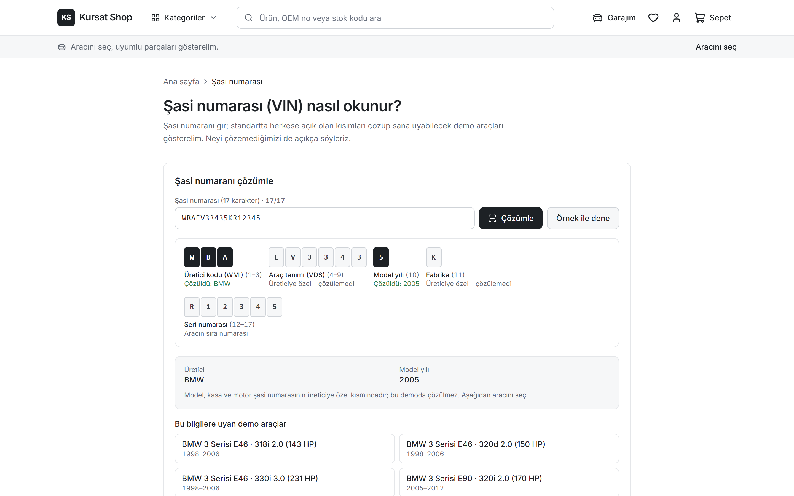
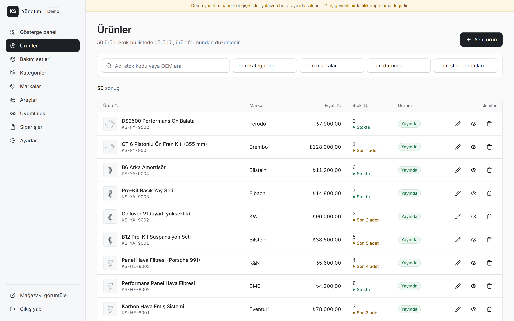
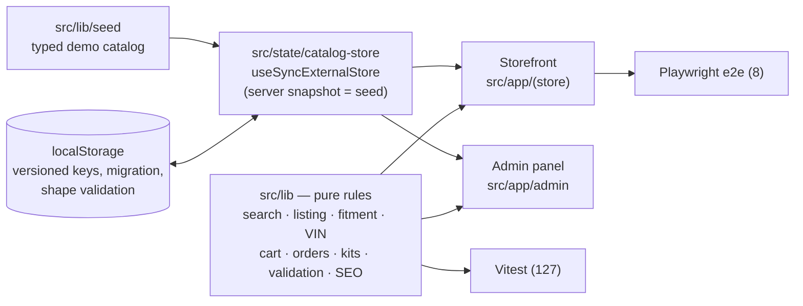

# Kursat Shop — fitment-first auto parts store (portfolio case study)

[](https://github.com/kursatdemirdelen/car-parts-shop/actions/workflows/ci.yml)
[](https://car-parts-shop-flame.vercel.app)

**Live demo:** https://car-parts-shop-flame.vercel.app · **Admin:** [/admin](https://car-parts-shop-flame.vercel.app/admin) (demo login is shown on the page)

> **Türkçe özet** — Kursat Shop, BMW ağırlıklı (Mercedes-Benz, Porsche, Audi) bir yedek parça mağazasının uçtan uca çalışan
> **demo** prototipidir. Odak noktası "bu parça benim arabama uyar mı?" sorusunu dürüstçe cevaplamak: uyumluluk yalnızca açık
> bir kayıt varsa "doğrulanmış" gösterilir, kayıt yoksa asla "uyumlu" denmez. OEM numarasıyla (boşluklu/noktalı yazılsa bile)
> arama, adım adım ve şasi numarasıyla araç seçimi, araç ve OEM sayfaları, bakım setleri, demo ödeme ve tam bir yönetim paneli
> içerir. Backend yoktur; veriler tarayıcıda tutulur. Gerçek ödeme veya sipariş işlenmez.


| Vehicle page with kits | VIN explainer | Admin | Mobile listing |
| --- | --- | --- | --- |
|  |  |  |  |

---

## The problem

Buying technical car parts online is still unusual in Türkiye. Industry reporting puts the online share of standard items (filters,
oil, accessories) around 12 %, but only about 5 % for technical parts, inside an aftermarket estimated at roughly USD 7–10 billion
(sources disagree; see [Sources](#sources)). The blocker is trust: *"Will this part fit my car?"*

Today many specialist sellers solve that by hand — search by OEM number, then send the chassis number to a sales rep who checks it.
Marketplaces win on commodity items (oil, cleaning products) on price; specialists can win on **fitment confidence**.

## Product decisions

| Decision | Why |
| --- | --- |
| **Three fitment states, never inferred.** *Doğrulanmış uyum* only with an explicit record; no record or an unverified record shows *Doğrulanmamış*; *Uyumsuz* only with an explicit record; consumables show *Araca bağlı değil*. | A wrong "fits" is worse than an honest "unknown". |
| **OEM-first search** with code normalization (`34 11 6 860 912` = `34.11.6.860.912` = `34116860912`), Turkish-aware text matching (works without ç/ğ/ı/ö/ş/ü) and mixed queries (`brembo 34116860912`). | People shop parts by part number. |
| **Two ways to pick a vehicle:** a 5-step cascading selector (make → model → generation → year → engine) and a **VIN decoder** that decodes only what the ISO 3779 standard makes public (manufacturer + model year) and says plainly what it cannot decode. | No paid fitment database; no guessing. |
| **Vehicle pages** (`/arac/bmw-e46-320d`) and **OEM pages** (`/oem/34116860912`, cross-references) with JSON-LD, sitemap and OG images. | Long-tail SEO is how parts shops get found. |
| **Maintenance kits** and **"usually replaced together"** suggestions, filtered to verified-fit parts for the selected vehicle. Kit price = sum of parts. | Larger baskets without fake discounts. |
| **Two-level category tree** (OEM parts / Performance / Care & cleaning). | Deep, meaningless category trees are a top complaint about existing sites. |
| **Demo honesty everywhere:** no ratings, reviews, fake discounts or certifications; checkout never asks for card data. | A portfolio piece shouldn't pretend to be a business. |

## Architecture



- **One data set.** Storefront and admin read and write the same catalog store; an admin edit shows up in the store immediately.
- **Hydration-safe persistence.** Server render and first client render use the seed; browser data is applied after hydration. Stored data
  is migrated (e.g. catalogs saved before kits existed), shape-checked per element, sanitized (dangling references dropped) and falls
  back to the seed when corrupt. A root error boundary offers a demo reset.
- **Business rules are pure functions** in `src/lib` and unit-tested; components stay thin.
- **Next.js 16 with Cache Components:** `params`/`searchParams` are awaited inside `Suspense`, seed products, categories, vehicles and OEM
  numbers are prerendered with `generateStaticParams`, and records created in the admin resolve in the browser.

## Quality

| Check | Result |
| --- | --- |
| Unit tests (Vitest) | 127 passing — search, filters, fitment, VIN, cart, orders, kits, validation, storage migration, SEO |
| End-to-end (Playwright, production build) | 8 passing — OEM search, vehicle fitment, kit to cart, checkout validation + order, admin create → store → delete, VIN flow; each checks 375 px overflow and uncaught errors |
| CI (GitHub Actions) | lint → typecheck → unit → build → e2e on every push |
| Lighthouse, mobile, live site | Home: Performance 93 · Accessibility 100 · Best Practices 100 · SEO 100<br/>Product: 95 · 100 · 100 · 100 |

## If this went to production

- **Backend:** replace `src/state/catalog-store.ts` + `src/lib/storage.ts` with an API and a database (products, stock, orders, fitment).
- **Auth:** server-side sessions and roles for the admin (the demo login is a browser flag, not security).
- **Stock integrity:** atomic decrement and reservation at order time.
- **Payments & shipping:** a licensed Turkish PSP with 3-D Secure; carrier integration and tracking.
- **Legal (TR):** KVKK notice and consent, distance-sales contract, pre-information form, returns, e-invoice.
- **Fitment data:** build it from verified chassis checks (each manual check becomes a record) or license a catalog such as TecDoc.
- **Business model options:** (A) niche specialist store for German cars, (B) B2B portal for workshops, (C) sell the fitment-aware
  storefront as SaaS to parts retailers.

## Getting started

Requirements: Node.js 20.9+ (CI uses 22), npm.

```bash
npm install
npm run dev          # http://localhost:3000
```

| Command | Description |
| --- | --- |
| `npm test` | Unit tests |
| `npm run lint` / `npm run typecheck` | ESLint / route types + `tsc --noEmit` |
| `npm run build` / `npm start` | Production build / serve |
| `npm run e2e:install` then `npm run e2e` | Playwright e2e against the production build (run `npm run build` first) |
| `node scripts/screenshots.mjs [url]` | Regenerate README screenshots |

Demo admin: `admin@kursatshop.demo` / `demo1234` (also shown on the login page).

Deploys: the Vercel project is connected to this repo; pushes to `master` deploy to production. Set `NEXT_PUBLIC_SITE_URL` to the
public URL so canonical links, sitemap and OG images use the right domain.

### Project structure

```
src/app/(store)      storefront routes (home, listings, product, /arac, /oem, /sasi-sorgula, cart, checkout, …)
src/app/admin        demo login + admin panel (products, kits, categories, brands, vehicles, compatibility, orders, settings)
src/lib              types, seed data, pure business rules, storage, SEO and structured data
src/state            localStorage-backed stores (catalog, cart, favorites, garage, admin session)
src/components       ui/, product/, store/, admin/, seo/
tests/ · e2e/        Vitest unit tests · Playwright specs
public/products      product illustrations (replace image paths with real photos)
docs/                brief, design specs, implementation plans, screenshots
```

## Limitations (by design)

- No backend: data lives in the browser's localStorage, per device; not shared, not durable, not secure.
- The admin login is presentation-only. No real payments, shipping or orders.
- Products, prices, OEM numbers, specs and fitment records are **demo data**; brand names are used only as sample catalog content.
- The VIN decoder only decodes manufacturer and model year. Vehicles, categories and products created in the admin are not prerendered.
- Product images are representative illustrations.

## Sources

- [Patron Rehberi — aftermarket report (online shares)](https://www.patronrehberi.com/otomotiv/38465/beklenen-rapor-satis-sonrasi-pazarini-sekillendiriyor/)
- [Kamyonum — Türkiye aftermarket 2025](https://m.kamyonum.com.tr/haber/Turkiye-Otomotiv-Satis-Sonrasi-Pazari-2025-te-Parlayacak/44961)
- [Donanımhaber — example of manual chassis-number checks by a BMW parts seller](https://forum.donanimhaber.com/bmw-yedek-parca-sitesi--160110979)
- [Promodo — auto parts e-commerce market 2026](https://www.promodo.com/blog/auto-parts-ecommerce-market-research)

Built with Next.js 16, React 19, TypeScript, Tailwind CSS 4, Vitest and Playwright.
